<!-- ANIMATED HEADER -->  
   
---

## 🚀 Featured Projects

<table>
  <tr>
    <td width="50%" valign="top">
      <h3>🍍 PineApple Music</h3>
      Ad-free Android music streaming app with a frosted-glass UI, synced lyrics, and automatic offline song cache.
        
      
      
      
    </td>
    <td width="50%" valign="top">
      <h3>🚌 School Transport Management System</h3>
      Full ERP for 50+ buses and 1,500+ students with role-based access, mobile-first PWA for drivers, and OCR odometer logging.
        
      
      
      
      
    </td>
  </tr>
  <tr>
    <td width="50%" valign="top">
      <h3>🥋 ISPC 2026 Live Scoreboard</h3>
      Multi-venue live scoring system with animated podiums, built for a two-day inter-school championship. Zero external hosting.
        
      
      
      
    </td>
    <td width="50%" valign="top">
      <h3>🌐 Personal Portfolio</h3>
      Dark, red-accent portfolio with scroll-driven animated map (Earth → India → Gangtok) and HUD-style hero.
        
      
      
      
    </td>
  </tr>
</table>

---

## 🛠️ Tech Stack

**Frontend** 

**Backend & Database** 

**Mobile** 

**Automation, Tools & Cloud** 

---

## 📊 GitHub Stats

---

## 🐍 Contribution Snake

<picture>
  <source media="(prefers-color-scheme: dark)" srcset="https://raw.githubusercontent.com/RickDas32k/RickDas32k/output/github-snake-dark.svg"/>
  <source media="(prefers-color-scheme: light)" srcset="https://raw.githubusercontent.com/RickDas32k/RickDas32k/output/github-snake.svg"/>
  
</picture>

